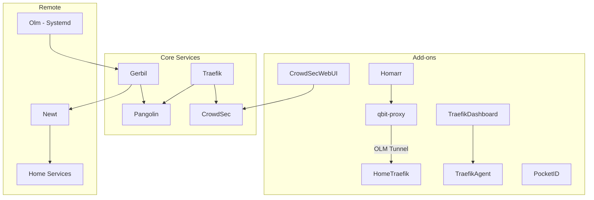

# Pangolin Stack Infrastructure

This document provides detailed infrastructure documentation for AI agents and developers working with this stack.

## Network Architecture

```
                                    ┌─────────────────────────────────────┐
                                    │            INTERNET                  │
                                    └──────────────────┬──────────────────┘
                                                       │
                                                       ▼
                                    ┌─────────────────────────────────────┐
                                    │           CLOUDFLARE                 │
                                    │    DNS: *.example.com → CloudNode IP       │
                                    │    Proxy: Orange cloud enabled       │
                                    └──────────────────┬──────────────────┘
                                                       │
                                                       ▼
┌──────────────────────────────────────────────────────────────────────────────────────┐
│                                   CloudNode (203.0.113.1)                            │
│                                                                                       │
│  ┌─────────────┐    ┌─────────────┐    ┌─────────────┐    ┌─────────────┐            │
│  │   Traefik   │◄───│  Pangolin   │    │   Gerbil    │    │  CrowdSec   │            │
│  │  :80, :443  │    │   :3001     │    │  :51820/udp │    │   :8080     │            │
│  └──────┬──────┘    └─────────────┘    └──────┬──────┘    └─────────────┘            │
│         │                                      │                                      │
│         ▼                                      │ WireGuard                            │
│  ┌─────────────┐    ┌─────────────┐            │ tunnel                               │
│  │   Homarr    │◄───┤  qbit-proxy │◄───────────┘                                      │
│  │   :7575     │    │   :8081     │  (via Olm)                                       │
│  └─────────────┘    └─────────────┘                                                   │
└────────────────────────────────────┬─────────────────────────────────────────────────┘
                              │
                              │ Olm (systemd) ── WireGuard ── Newt on rammus
                              ▼
┌──────────────────────────────────────────────────────────────────────────────────────┐
│                              LAN (192.168.0.0/24)                                     │
│                                                                                       │
│  ┌────────────────────────────────────┐   ┌────────────────────────────────────┐     │
│  │  rammus (192.168.0.12)             │   │  NASUS (192.168.0.10)              │     │
│  │  ── every application ──           │   │  ── storage only ──                │     │
│  │  newt, traefik :80/:443, hawser    │   │  NFSv3 exports:                    │     │
│  │  plex :32400, qbittorrent :8080    │   │    /volume1/media                  │     │
│  │  prowlarr, scryer, arr-mcp         │   │    /volume1/storage                │     │
│  │  dashdot :3003                     │   │    /volume1/backups                │     │
│  │  appdata: /opt/docker/config       │◄──┤    /volume2/fast                   │     │
│  │  (local SSD, never NFS)            │NFS│  ADM UI :9980, zero containers     │     │
│  └────────────────────────────────────┘   └────────────────────────────────────┘     │
│                                                                                       │
│  OPNsense router (192.168.0.1): AdGuard Home :53 holds every *.example.com rewrite   │
│  pointing at 192.168.0.12, plus the NAT forwards for 32400 and 6881                  │
└──────────────────────────────────────────────────────────────────────────────────────┘
```

## Service Dependencies



## Docker Compose Stacks

Stacks are organized in `stacks/<stack>/docker-compose.yml`:

| Stack | Purpose | Services |
|-------|---------|----------|
| `core` | Infrastructure (starts first) | pangolin, gerbil, traefik |
| `security` | Protection & auth | crowdsec, crowdsec-web-ui, pocket-id |
| `observability` | Monitoring & logs | traefik-agent, traefik-dashboard, dashdot |
| `management` | Container orchestration | dockhand |
| `dashboard` | User dashboards | homarr, qbit-proxy |
| `apps` | User applications | linkstack, termix |

Use `./stackctl.sh status` to view all stacks or `./startup.sh` to start everything.

## Repository Template Pins

The values below describe older templates. Live verification on 2026-10-27
found Pangolin `1.25.3`, Gerbil `1.5.2`, Traefik `v3.7.16`, CrowdSec Web UI
`2026.10.10`, Newt `1.19.0`, and Olm `1.9.1`. Consult the
[maintenance record](docs/wiki/maintenance-2026-10-27.md) for current observed
state; do not use these older templates as an in-place deployment plan.

- Pangolin: `fosrl/pangolin:1.17.0`
- Gerbil: `fosrl/gerbil:1.3.1`
- Traefik Badger plugin: `github.com/fosrl/badger@v1.4.0`
- CrowdSec Web UI: `ghcr.io/theduffman85/crowdsec-web-ui:2026.3.1`
- Newt (rammus): `fosrl/newt:1.19.0`
- Olm (CloudNode systemd binary): verified `1.9.1` with `--override-dns=false` on 2026-10-27

Compatibility note: Newt `1.11.x` aligns with Pangolin `1.17.x` for private resource connection logging and the newer provisioning-key site onboarding flow.
Operational note: CrowdSec Web UI is pinned to `2026.3.1` because the `latest` tag pulled a broken image on March 30, 2026.

Upgrade policy: read official Pangolin docs plus release notes for Pangolin, Gerbil, Newt, Olm, and Badger before applying image or binary changes.

## Core Stack Coupling

- Traefik uses `network_mode: service:gerbil`, so it shares Gerbil's network namespace and does not have its own Docker network attachment.
- If `gerbil` is recreated or replaced during an upgrade, `traefik` must also be recreated afterward. Otherwise Traefik can remain attached to the old Gerbil container namespace and public `80/443` can fail even though both containers show as running.
- Recovery command:

```bash
docker compose -f stacks/core/docker-compose.yml --env-file .env up -d --force-recreate traefik
```


## Olm Tunnel Configuration

Olm is currently running as a **systemd service** on the CloudNode host to ensure it has the necessary network permissions and stability.
The CloudNode also pins `pangolin.example.com` to `203.0.113.1` in `/etc/hosts` so Olm does not depend on external resolver behavior for its own endpoint.

The service loads credentials through `CONFIG_FILE=/root/.config/olm-client/config.json`.
The populated file stays root-owned `0600`, its directory `0700`, and the unit
sets `UMask=0077`. Keep `--override-dns=false` explicitly on the command line,
but no credential flags. The sanitized unit is in
`host-configs/cloudnode/systemd/olm.service`; rotation and recovery notes are
in [Olm operations](docs/wiki/services/olm.md).

### Management
```bash
sudo systemctl status olm
sudo journalctl -u olm -f
sudo systemctl status olm-watchdog.timer
```

### Failure Check

If Dockhand on the CloudNode cannot reach rammus at `192.168.0.12:2375`, verify that Olm still owns the LAN route:

```bash
ip route | grep 192.168.0.0/24
sudo journalctl -u olm -n 100 --no-pager
```

Healthy output includes:

```bash
192.168.0.0/24 dev olm
```

### Reliability Guards

- CloudNode watchdog: `/usr/local/sbin/olm-watchdog.sh` with systemd timer `olm-watchdog.timer`.
- rammus watchdog: `/usr/local/bin/newt-watchdog.sh` + `/etc/cron.d/newt-watchdog`, every minute. It starts `newt` when down and restarts it on tunnel-interface failure.
- Do not recreate the old NASUS `newt-watchdog` cron. A leftover copy there kept starting a second `newt` on the same site credentials, which flapped the tunnel and produced intermittent 502s. It was removed on 2026-11-21.

### Application Container Healthchecks (rammus)

Healthchecks are defined in the live compose files on rammus. Current state:

- Healthy checks: `traefik`, `plex`, `prowlarr`, `scryer`, `arr-mcp`, `hawser`
- No native healthcheck: `newt`, `qbittorrent`, `dashdot` — process availability
  is a weaker signal. For `newt`, the watchdog is the real availability check.

FileFlows and `fileflows-dv-watcher` were decommissioned on 2026-10-27. Their deployment files, dedicated data, routes and active service references have been removed. Historical backups must not reintroduce either service.

Live host paths (rammus, `192.168.0.12`):

- `/opt/docker/stacks/<service>/docker-compose.yml`
- `/opt/docker/config/<service>` (appdata, always on local SSD)
- `/opt/docker/hawser/docker-compose.yml` (Hawser does not follow the pattern)

NASUS (`192.168.0.10`) runs **zero containers** as of 2026-11-21. Its old
`/volume1/docker/config/*` trees are rollback material and history only.

Repo backup paths:

- `host-configs/homenode/<service>/docker-compose.yml` — **stale**, do not deploy

## Dockhand API

Use the Dockhand container's internal HTTP endpoint over SSH to the CloudNode for automation. The public `https://dockhand.example.com` URL is fronted by Pangolin auth and is not the right path for CLI API calls.

Verified flow:

```bash
ssh user@example.com '
DOCKHAND_IP=$(docker inspect -f "{{range .NetworkSettings.Networks}}{{.IPAddress}} {{end}}" dockhand | awk "{print \$1}")

curl -skD /tmp/dockhand.headers \
  -c /tmp/dockhand.cookie \
  -X POST \
  -H "Content-Type: application/json" \
  -d "{\"username\":\"admin\",\"password\":\"<dockhand-local-password>\"}" \
  "http://${DOCKHAND_IP}:3000/api/auth/login"

TOKEN=$(awk "/dockhand_session/ {print \$7}" /tmp/dockhand.cookie)
curl -sk -H "Cookie: dockhand_session=${TOKEN}" \
  "http://${DOCKHAND_IP}:3000/api/stacks?env=3"
'
```

Environment IDs:
- `1` = CloudNode
- `2` = Nasus (`192.168.0.10`) — stale, no Hawser there since 2026-11-21
- `3` = Rammus (`192.168.0.12`) — the live home environment
Common API endpoints:
- `GET /api/containers?env=<id>`
- `GET /api/stacks?env=<id>`
- `GET /api/git/stacks?env=<id>`
- `POST /api/git/stacks/{id}/deploy?env=<id>`
- `POST /api/containers/{id}/restart?env=<id>`

## qBittorrent Proxy Sidecar

Homarr v0.15+ has a known issue with qBittorrent v5.1.4+ API responses when served over HTTPS with "Secure" cookies. The `qbit-proxy` service acts as a bridge:

1. **Strips Secure Flag**: Removes `secure;` from cookies so Homarr can see them.
2. **Selects the upstream host**: Sets `Host: torrent.example.com`; Node derives TLS SNI from this header.
3. **Internal HTTP**: Allows Homarr to connect via plain HTTP internally.
4. **Verifies TLS**: Uses Node 24's certificate validation for the upstream HTTPS connection.
5. **Bounds failures**: Aborts requests after 10 seconds. The Docker healthcheck requires a successful version response through the proxy within 8 seconds.

An unhealthy proxy can indicate an upstream or tunnel outage. Its healthcheck does not restart the stack.

### Access Pattern

```
Widget URL: http://qbit-proxy:8081
    ↓ Proxy translation
Destination: https://192.168.0.12:443
    ↓ SNI injection
Host Header: torrent.example.com
    ↓ OLM tunnel
rammus Traefik
```

### Widget Access Pattern

```
Widget URL: https://prowlarr.example.com
    ↓ extra_hosts override in the Homarr container
Resolved: 192.168.0.12:443
    ↓ Olm tunnel
rammus Traefik (SNI routing)
    ↓
prowlarr container
```

Both pins must match the host actually running the service. The `extra_hosts`
entries live in the Homarr container, not on the CloudNode host, so they override
DNS and `/etc/hosts` alike. `sonarr` no longer runs — use this pattern for
`prowlarr`, `torrent`, `nasus`, `adguard`, `plex`, and `request`.

## Backup Coverage and Consistency

`backup.sh` uses private staging and `0600` archives, with validated online SQLite
snapshots for Pangolin, CrowdSec, CrowdSec Web UI, Pocket ID, Dockhand and Homarr.
It includes landing sites, proxy source, complete CrowdSec configuration and
restricted runtime/host recovery metadata. Compressed archives are validated
before publication or pruning. Databases are individually consistent, rather
than one atomic transaction across services. Archive validation and actual
application restoration are separate checks; their verified scope is recorded in
[the maintenance record](docs/wiki/maintenance-2026-10-27.md).

## Traefik Config

- Static config: `config/traefik/traefik_config.yml`
- Dynamic rules: `config/traefik/rules/`
- Overrides are disabled and kept as `config/traefik/rules/resource-overrides.yml.back`

## Troubleshooting Commands

### Olm Tunnel

```bash
# Check tunnel status
sudo systemctl status olm
sudo journalctl -u olm -f

# Verify interface exists
ip addr show olm

# Test connectivity
ping 192.168.0.12

# Check routes
ip route | grep 192.168.0

# Restart tunnel
sudo systemctl restart olm
```
If you run Olm via Docker instead of systemd, use `docker logs olm` and `docker restart olm`.

## Geo-Blocking

The stack implements defense-in-depth geo-blocking using both CrowdSec and Traefik to block traffic from high-risk countries.

### Configuration

**Blocked Countries**: CN, RU, KP, IR, VN, IN, PK, BD, NG, BR, ID, UA, KZ  
**Whitelisted**: IL (Israel), EU member states, US, CA, GB, AU, NZ, JP, KR, SG

### Components

1. **CrowdSec GeoIP Enrichment** (`config/crowdsec/scenarios/country-block.yaml`)
   - Enriches logs with country data
   - Bans IPs from blocked countries for 24 hours
   - Uses `crowdsecurity/geoip-enrich` parser

2. **Traefik GeoBlock Middleware** (`config/traefik/rules/geoblock-middleware.yml`)
   - Immediate edge blocking using GeoJS API
   - Applied to: LinkStack, Termix, Homarr, Dashdot
   - Not applied to: PocketID (has own MaxMind), Pangolin, CrowdSec, Dockhand

### Management

```bash
# View geo-blocking alerts
docker exec crowdsec cscli alerts list --origin custom/country-block

# Check blocked decisions
docker exec crowdsec cscli decisions list

# Whitelist an additional country: edit both files
# - config/crowdsec/scenarios/country-block.yaml
# - config/traefik/rules/geoblock-middleware.yml
# Then restart services
docker restart crowdsec
./stackctl.sh restart core
```

## Blocklist Import

The stack imports 60,000+ IPs from 28 public threat feeds into CrowdSec for proactive blocking. This provides premium-level threat protection using free, curated feeds like IPsum, Spamhaus, Firehol, and Abuse.ch.

### Running Manually

```bash
# Using the helper script
./scripts/blocklist-import.sh

# Or run directly
curl -sL https://raw.githubusercontent.com/wolffcatskyy/crowdsec-blocklist-import/main/import.sh | \
    MODE=docker CROWDSEC_CONTAINER=crowdsec bash
```

### Scheduled Import (Recommended)

Add to crontab for daily refresh at 4 AM:

```bash
crontab -e
# Add this line:
0 4 * * * /opt/homelab/scripts/blocklist-import.sh
```

### View Imported Decisions

```bash
# Count imported decisions
docker exec crowdsec cscli decisions list | grep external_blocklist | wc -l

# List recent blocklist decisions
docker exec crowdsec cscli decisions list -l 20 | grep external_blocklist

# Remove all imported decisions (if needed)
docker exec crowdsec cscli decisions delete --all --reason external_blocklist
```


### CrowdSec

```bash
# Check decisions
docker exec crowdsec cscli decisions list

# Check bouncers
docker exec crowdsec cscli bouncers list

# View alerts
docker exec crowdsec cscli alerts list

# Geo-blocking metrics
docker exec crowdsec cscli metrics
docker exec crowdsec cscli alerts list -l 20 --origin custom/country-block

# Verify GeoIP enrichment is active
docker exec crowdsec cscli parsers list | grep geoip

# Verify country-block scenario is loaded
docker exec crowdsec cscli scenarios list | grep country
```

## Environment Variables

Key variables in `.env`:

| Variable | Purpose |
|----------|---------|
| `TRAEFIK_DASHBOARD_TOKEN` | Auth token for traefik-dashboard |
| `CROWDSEC_AGENT_KEY` | CrowdSec agent registration key |
| `CROWDSEC_WEB_UI_PASSWORD` | CrowdSec Web UI login |
| `HOMARR_SECRET_KEY` | Homarr encryption key |
| `TELEGRAM_BOT_TOKEN` | Telegram bot token for notifications |
| `TELEGRAM_CHAT_ID` | Telegram chat ID for notifications |
| `POCKET_ID_APP_URL` | Pocket ID public URL |
| `POCKET_ID_ENCRYPTION_KEY` | Pocket ID encryption secret |
| `POCKET_ID_TRUST_PROXY` | Pocket ID proxy trust flag |
| `MAXMIND_ACCOUNT_ID` | MaxMind account ID for Pocket ID |
| `MAXMIND_LICENSE_KEY` | MaxMind license key for Pocket ID |
| `DISABLE_ONLINE_API` | CrowdSec online API toggle |
| `DISABLE_HUB_UPDATE` | CrowdSec hub update toggle |

## Permissions Notes

| Path | Required Owner | Why |
|------|----------------|-----|
| `config/crowdsec-web-ui/` | Container writable | SQLite database |
| `/var/run/docker.sock` | root:docker (986) | Docker API access |

If permissions break, fix with:
```bash
sudo chmod 666 config/crowdsec-web-ui/crowdsec.db*

```
